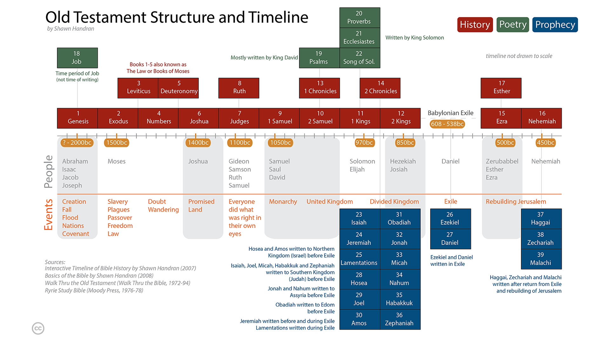
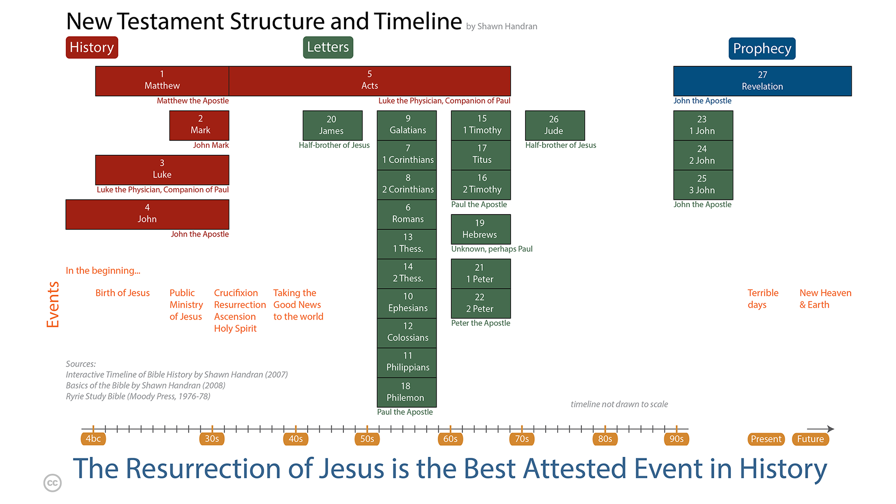

Provides a better understanding of when the events described in the Bible occurred in history. 
Available in over a dozen languages.
{:.note}

{:.lead width="800" height="100" loading="lazy"}
Old Testament Structure and Timeline
{:.figcaption}

{:.lead width="800" height="100" loading="lazy"}
New Testament Structure and Timeline
{:.figcaption}

* BST in English
* Translated versions
* BST Source Files
{:toc}

## BST in English

[Old Testament Structure and Timeline — English project page](/projects/bstot/) · [New Testament Structure and Timeline — English project page](/projects/bstnt/)

[PDF](../assets/pdfs/BibleStructureTimeline.pdf){:.heading.flip-title} {{ site.data.strings.large_separator }}
[PNG OT](../assets/img/hd/bstothd.png){:.heading.flip-title} {{ site.data.strings.large_separator }}
[PNG NT](../assets/img/hd/bstnthd.png){:.heading.flip-title} 

## Translated versions  
### العربية Arabic 

[Bible Structure and Timeline — Arabic project page](/projects/bstarabic/)

[PDF](../assets/pdfs/الترتيبالزمنيوالهيكليالكتابالمقدس.pdf){:.heading.flip-title} {{ site.data.strings.large_separator }}
[PNG OT](../assets/img/hd/bstothdarabic.png){:.heading.flip-title} {{ site.data.strings.large_separator }}
[PNG NT](../assets/img/hd/bstnthdarabic.png){:.heading.flip-title} 

### Bahasa Indonesian

[Bible Structure and Timeline — Indonesian project page](/projects/bstbahasaindonesia/)

[PDF](../assets/pdfs/StrukturdanKronologiAlkitab_BahasaIndonesia.pdf){:.heading.flip-title} {{ site.data.strings.large_separator }}
[PNG OT](../assets/img/hd/bstothdbahasaindonesia.png){:.heading.flip-title} {{ site.data.strings.large_separator }}
[PNG NT](../assets/img/hd/bstnthdbahasaindonesia.png){:.heading.flip-title} 

### 简体中文 Chinese (Simplified)

[Bible Structure and Timeline — Simplified Chinese project page](/projects/bstsimplified/)

[PDF](../assets/pdfs/圣经架构与时间表(简化字).pdf){:.heading.flip-title} {{ site.data.strings.large_separator }}
[PNG OT](../assets/img/hd/bstothdsimplified.png){:.heading.flip-title} {{ site.data.strings.large_separator }}
[PNG NT](../assets/img/hd/bstnthdsimplified.png){:.heading.flip-title} 

### 繁體中文 Chinese (Traditional)

[Bible Structure and Timeline — Traditional Chinese project page](/projects/bsttraditional/)

[PDF](../assets/pdfs/聖經架構與時間表(繁體字).pdf){:.heading.flip-title} {{ site.data.strings.large_separator }}
[PNG OT](../assets/img/hd/bstothdtraditional.png){:.heading.flip-title} {{ site.data.strings.large_separator }}
[PNG NT](../assets/img/hd/bstnthdtraditional.png){:.heading.flip-title} 

### Chinese (Pinyin)

[Bible Structure and Timeline — Chinese Pinyin project page](/projects/bstpinyin/)

[PDF](../assets/pdfs/SimplifiedChinesePinyin.pdf){:.heading.flip-title} {{ site.data.strings.large_separator }}
[PNG OT](../assets/img/hd/bstothdpinyin.png){:.heading.flip-title} {{ site.data.strings.large_separator }}
[PNG NT](../assets/img/hd/bstnthdpinyin.png){:.heading.flip-title} 

### Français French

[Bible Structure and Timeline — French project page](/projects/bstfrench/)

[PDF](../assets/pdfs/StructureBibliqueEtChronologie.pdf){:.heading.flip-title} {{ site.data.strings.large_separator }}
[PNG OT](../assets/img/hd/bstothdfrench.png){:.heading.flip-title} {{ site.data.strings.large_separator }}
[PNG NT](../assets/img/hd/bstnthdfrench.png){:.heading.flip-title} 

### Deutsch German

[Bible Structure and Timeline — German project page](/projects/bstgerman/)

[PDF](../assets/pdfs/GliederungUndZeitleisteDerBibel.pdf){:.heading.flip-title} {{ site.data.strings.large_separator }}
[PNG OT](../assets/img/hd/bstothdgerman.png){:.heading.flip-title} {{ site.data.strings.large_separator }}
[PNG NT](../assets/img/hd/bstnthdgerman.png){:.heading.flip-title} 

###  हिंदी भाषा Hindi

[Bible Structure and Timeline — Hindi project page](/projects/bsthindi/)

[PDF](../assets/pdfs/बाइबिलसंरचनाऔरसमयरेखा.pdf){:.heading.flip-title} {{ site.data.strings.large_separator }}
[PNG OT](../assets/img/hd/bstothdhindi.png){:.heading.flip-title} {{ site.data.strings.large_separator }}
[PNG NT](../assets/img/hd/bstnthdhindi.png){:.heading.flip-title} 

### Magyar Hungarian

[Bible Structure and Timeline — Hungarian project page](/projects/bsthungarian/)

[PDF](../assets/pdfs/BibliaSzerkezeteEsIdorendje.pdf){:.heading.flip-title} {{ site.data.strings.large_separator }}
[PNG OT](../assets/img/hd/bstothdhungarian.png){:.heading.flip-title} {{ site.data.strings.large_separator }}
[PNG NT](../assets/img/hd/bstnthdhungarian.png){:.heading.flip-title} 

### Italiano Italian

[Bible Structure and Timeline — Italian project page](/projects/bstitalian/)

[PDF](../assets/pdfs/StrutturaELineaCronologicaDellaBibbia.pdf){:.heading.flip-title} {{ site.data.strings.large_separator }}
[PNG OT](../assets/img/hd/bstothditalian.png){:.heading.flip-title} {{ site.data.strings.large_separator }}
[PNG NT](../assets/img/hd/bstnthditalian.png){:.heading.flip-title} 

###  日本語 Japanese

[Bible Structure and Timeline — Japanese project page](/projects/bstjapanese/)

[PDF](../assets/pdfs/聖書の構造と時系列.pdf){:.heading.flip-title} {{ site.data.strings.large_separator }}
[PNG OT](../assets/img/hd/bstothdjapanese.png){:.heading.flip-title} {{ site.data.strings.large_separator }}
[PNG NT](../assets/img/hd/bstnthdjapanese.png){:.heading.flip-title} 

### 한국어 Korean

[Bible Structure and Timeline — Korean project page](/projects/bstkorean/)

[PDF](../assets/pdfs/성경의구조와%20연대기.pdf){:.heading.flip-title} {{ site.data.strings.large_separator }}
[PNG OT](../assets/img/hd/bstothdkorean.png){:.heading.flip-title} {{ site.data.strings.large_separator }}
[PNG NT](../assets/img/hd/bstnthdkorean.png){:.heading.flip-title} 

### Português Portuguese

[Bible Structure and Timeline — Portuguese project page](/projects/bstportuguese/)

[PDF](../assets/pdfs/EstruturaBiblicaECronologia.pdf){:.heading.flip-title} {{ site.data.strings.large_separator }}
[PNG OT](../assets/img/hd/bstothdportuguese.png){:.heading.flip-title} {{ site.data.strings.large_separator }}
[PNG NT](../assets/img/hd/bstnthdportuguese.png){:.heading.flip-title} 

### Русский Russian

[Bible Structure and Timeline — Russian project page](/projects/bstrussian/)

[PDF](../assets/pdfs/БиблейскаяСтруктураиИсторическаяЛиния.pdf){:.heading.flip-title} {{ site.data.strings.large_separator }}
[PNG OT](../assets/img/hd/bstothdrussian.png){:.heading.flip-title} {{ site.data.strings.large_separator }}
[PNG NT](../assets/img/hd/bstnthdrussian.png){:.heading.flip-title} 

### Español Spanish

[Bible Structure and Timeline — Spanish project page](/projects/bstspanish/)

[PDF](../assets/pdfs/EstructuraBiblicaYCronograma.pdf){:.heading.flip-title} {{ site.data.strings.large_separator }}
[PNG OT](../assets/img/hd/bstothdspanish.png){:.heading.flip-title} {{ site.data.strings.large_separator }}
[PNG NT](../assets/img/hd/bstnthdspanish.png){:.heading.flip-title} 

### ภาษาไทย Thai

[Bible Structure and Timeline — Thai project page](/projects/bstthai/)

[PDF](../assets/pdfs/โครงสร้างและช่วงเวลาในพระคัมภีร์.pdf){:.heading.flip-title} {{ site.data.strings.large_separator }}
[PNG OT](../assets/img/hd/bstothdthai.png){:.heading.flip-title} {{ site.data.strings.large_separator }}
[PNG NT](../assets/img/hd/bstnthdthai.png){:.heading.flip-title} 

### Tiếng Việt Vietnamese

[Bible Structure and Timeline — Vietnamese project page](/projects/bstvietnamese/)

[PDF](../assets/pdfs/VietnameseBST.pdf){:.heading.flip-title} {{ site.data.strings.large_separator }}
[PNG OT](../assets/img/hd/bstothdvietnamese.png){:.heading.flip-title} {{ site.data.strings.large_separator }}
[PNG NT](../assets/img/hd/bstnthdvietnamese.png){:.heading.flip-title} 

## BST Source Files
Create your own translation of the Bible Structure and Timeline in Adobe Illustrator or Microsoft Publisher.

* [Illustrator](../assets/zip/Illustrator.zip){:.heading.flip-title} files (LTR format)  (2.1 MB zip)
* [Publisher](../assets/zip/Publisher.zip){:.heading.flip-title} files (RTL format)  (0.2 MB zip)
