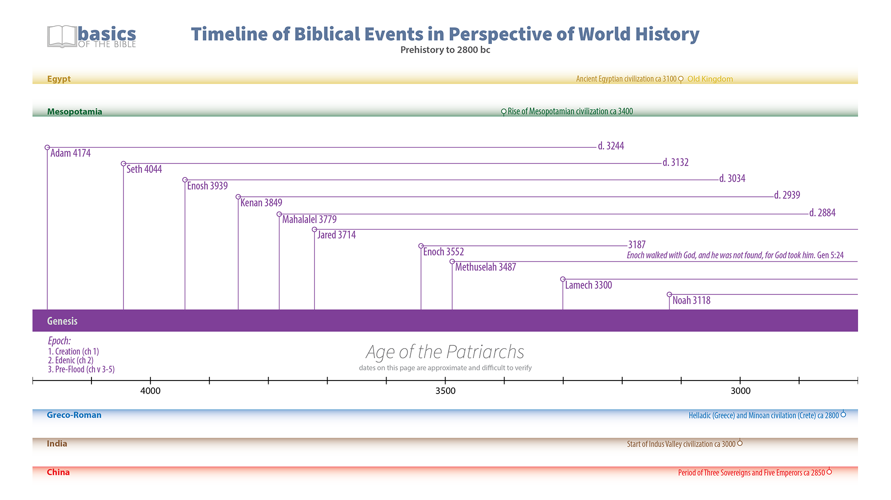
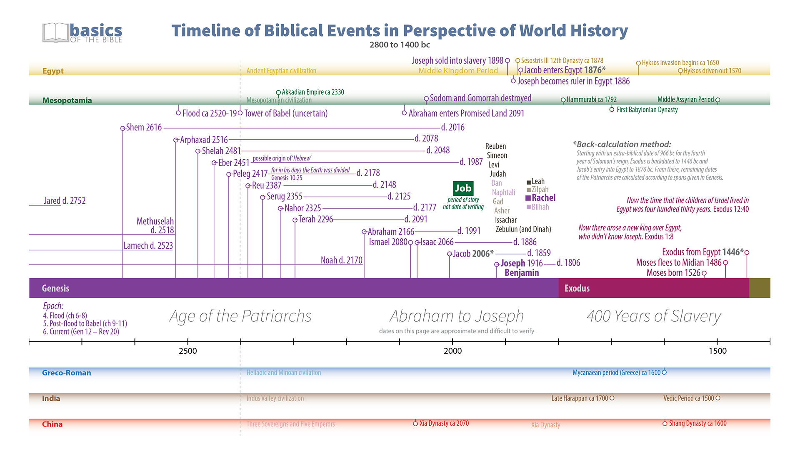
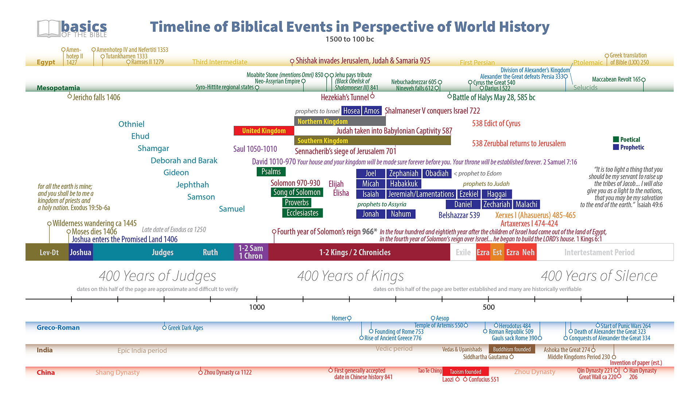
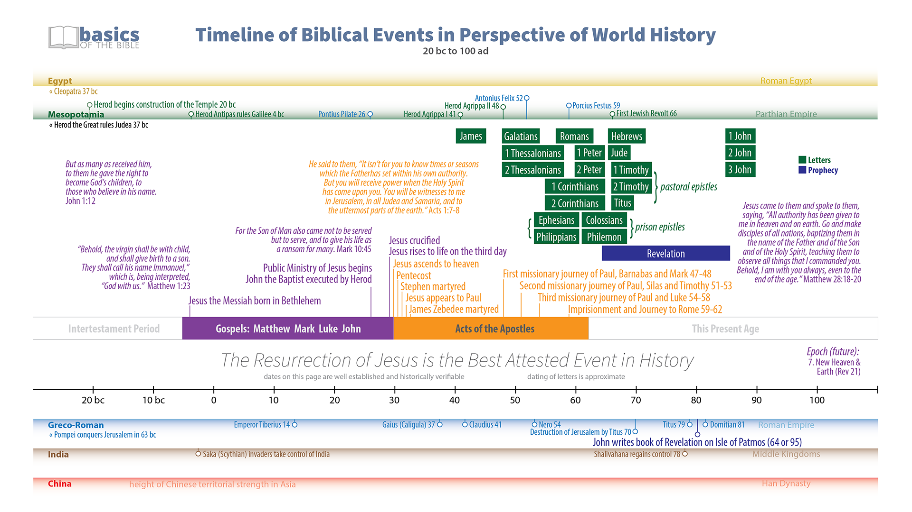

*Timeline of Biblical Events* helps readers see the events of Scripture within the broader setting of world history and the major societies of the ancient world. This revised edition commemorates the 20th anniversary of the original 2007 *Interactive Timeline of Bible History* graphic while presenting the biblical storyline with renewed clarity and historical perspective.  
Also available in Simplified Chinese.
{:.note}

{:.lead width="800" height="100" loading="lazy"}
Timeline of Biblical Events: Prehistory to 2800 bc
{:.figcaption}

{:.lead width="800" height="100" loading="lazy"}
Timeline of Biblical Events: 2800 bc to 1400 bc
{:.figcaption}

{:.lead width="800" height="100" loading="lazy"}
Timeline of Biblical Events: 1500 bc to 100 bc
{:.figcaption}

{:.lead width="800" height="100" loading="lazy"}
Timeline of Biblical Events: 20 bc to 100 ad
{:.figcaption}

* TBE in English
* Translated versions
{:toc}

# TBE in English
[PDF](../assets/pdfs/TimelineOfBiblicalEvents.pdf){:.heading.flip-title} {{ site.data.strings.large_separator }}
[PNG 1](../assets/img/hd/tbe1hd.png){:.heading.flip-title} {{ site.data.strings.large_separator }}
[PNG 2](../assets/img/hd/tbe2hd.png){:.heading.flip-title} 
[PNG 3](../assets/img/hd/tbe3hd.png){:.heading.flip-title} 
[PNG 4](../assets/img/hd/tbe4hd.png){:.heading.flip-title} 

# Translated versions  
## 简体中文 Chinese (Simplified)
[PDF](../assets/pdfs/){:.heading.flip-title} {{ site.data.strings.large_separator }}
[PNG 1](../assets/img/hd/tbe1hdsc.png){:.heading.flip-title} {{ site.data.strings.large_separator }}
[PNG 2](../assets/img/hd/tbe2hdsc.png){:.heading.flip-title} 
[PNG 3](../assets/img/hd/tbe3hdsc.png){:.heading.flip-title} 
[PNG 4](../assets/img/hd/tbe4hdsc.png){:.heading.flip-title} 