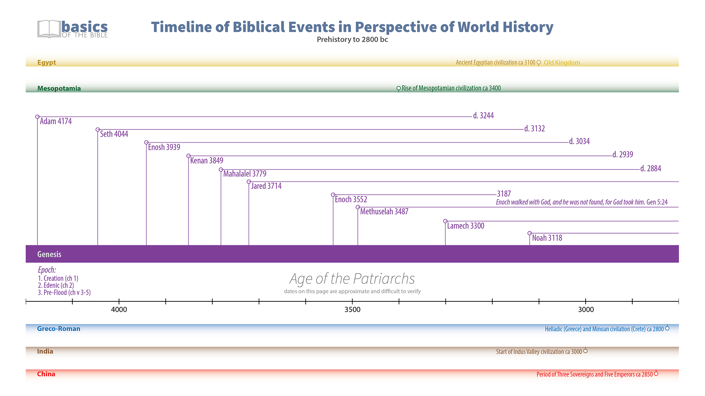
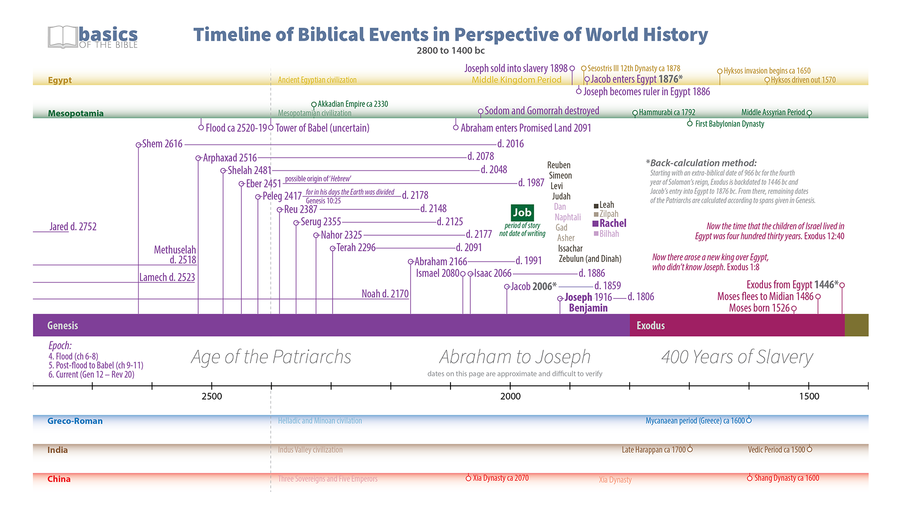
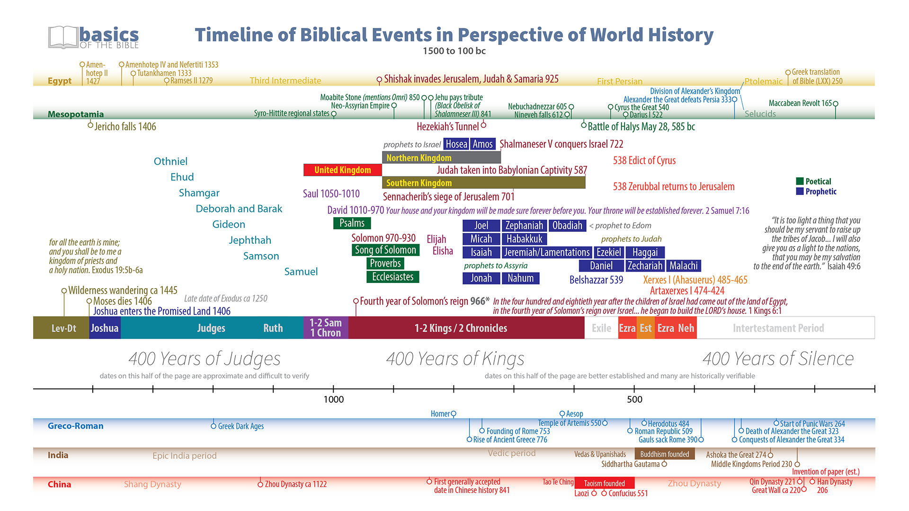
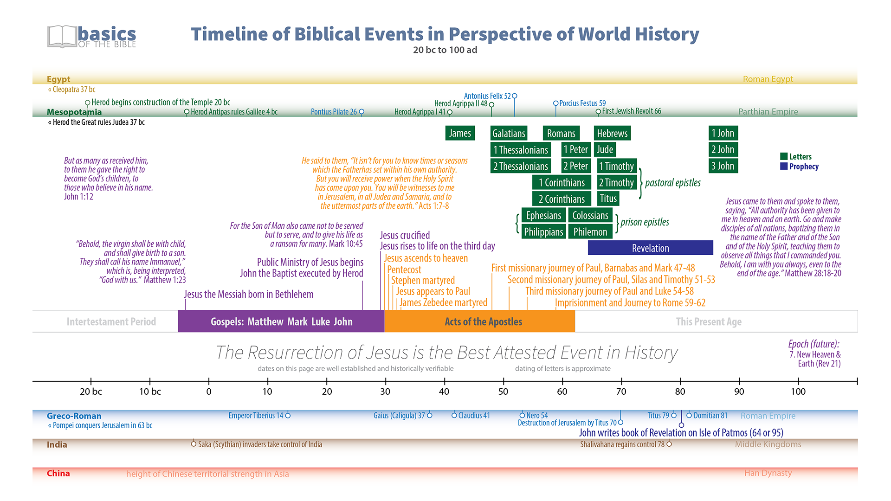

I created *Timeline of Biblical Events* to place biblical people, events, and books alongside the wider setting of world history. Across four graphics, a central biblical timeline is accompanied by parallel bands for Egypt, Mesopotamia, the Greco-Roman world, India, and China.

Lifespan lines, colored book labels, event markers, and selected Scripture passages help readers connect the biblical narrative with its historical setting. The graphics use different time scales, and their notes identify approximate dates and explain selected chronological choices.

Explore the four eras below, or download the complete four-page PDF for landscape printing on legal-size paper.

## [Prehistory to 2800 BC](/projects/tbeprehistory/)

[{:.lead width="800" height="450" loading="lazy"}](/projects/tbeprehistory/)

## [2800 BC to 1400 BC](/projects/tbe2800bc/)

[{:.lead width="800" height="450" loading="lazy"}](/projects/tbe2800bc/)

## [1500 BC to 100 BC](/projects/tbe1500bc/)

[{:.lead width="800" height="450" loading="lazy"}](/projects/tbe1500bc/)

## [20 BC to 100 AD](/projects/tbe20bc/)

[{:.lead width="800" height="450" loading="lazy"}](/projects/tbe20bc/)

## Downloads

[Complete Timeline of Biblical Events (PDF)](/assets/pdfs/TimelineOfBiblicalEvents.pdf){:.heading.flip-title}  All 4 pages, legal landscape (14 × 8.5 in), 1.0 MB

[Prehistory to 2800 BC — high-resolution PNG](/assets/img/hd/tbe1hd.png){:.heading.flip-title}  0.3 MB

[2800 BC to 1400 BC — high-resolution PNG](/assets/img/hd/tbe2hd.png){:.heading.flip-title}  0.6 MB

[1500 BC to 100 BC — high-resolution PNG](/assets/img/hd/tbe3hd.png){:.heading.flip-title}  0.7 MB

[20 BC to 100 AD — high-resolution PNG](/assets/img/hd/tbe4hd.png){:.heading.flip-title}  0.6 MB

## 简体中文 — Simplified Chinese

1. [史前时期至公元前2800年](/projects/tbeprehistorysimplified/)
2. [公元前2800年至1400年](/projects/tbe2800bcsimplified/)
3. [公元前1500年至100年](/projects/tbe1500bcsimplified/)
4. [公元前20年至公元100年](/projects/tbe20bcsimplified/)

[完整圣经事件时间轴（PDF）](/assets/pdfs/tbesimplifiedchinese.pdf){:.heading.flip-title}  共4页，Legal规格横向打印（14 × 8.5英寸）

## 繁體中文 — Traditional Chinese

1. [史前時期至公元前2800年](/projects/tbeprehistorytraditional/)
2. [公元前2800年至1400年](/projects/tbe2800bctraditional/)
3. [公元前1500年至100年](/projects/tbe1500bctraditional/)
4. [公元前20年至公元100年](/projects/tbe20bctraditional/)

[完整聖經事件時間軸（PDF）](/assets/pdfs/tbetraditionalchinese.pdf){:.heading.flip-title}  共4頁，Legal規格橫向列印（14 × 8.5英吋）
